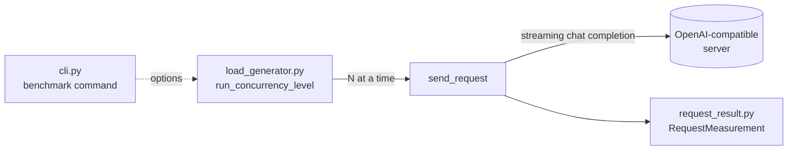

# LLMPerf

LLMPerf is a command-line tool for benchmarking how fast a large language model responds when it is served behind an OpenAI-compatible API (for example [Ollama](https://ollama.com), vLLM or llama.cpp's server), and how that speed changes as more requests hit the server at the same time.

> **Status: early prototype.** The pieces exist but are not wired together yet. The CLI parses and validates its options and prints them. The load generator runs on its own with hard-coded settings. See [Current status](#current-status) and [Roadmap](#roadmap).

## The problem it answers

When you serve an LLM, the practical question is: **how many simultaneous users can this deployment handle before the experience gets bad?**

A single request tells you little. Under load, requests queue up and compete for the GPU, so the time to the first word grows and each user's text streams more slowly. LLMPerf answers the question with a **concurrency sweep**: it sends a batch of streaming requests at 1, 2, 4, 8, 16 and 32 requests in flight, and records high-resolution timestamps for every request. From those timestamps it derives the standard inference metrics, so you can see where latency starts to climb.

Typical uses:

- Choosing hardware or a serving engine for a given number of users.
- Comparing models, quantizations or server settings on the same machine.
- Catching performance regressions after changing a deployment.

## Metrics

Every request is recorded as a `RequestMeasurement` (see `request_result.py`). For one streaming request the timestamps fall like this:

```
request_start_time        first_token_time                         completion_time
        |------- ttft --------|---------- generation_time ----------------|
        |  queue + prefill    |  ▮  ▮  ▮  ▮  ▮  ▮  ▮  ▮  ▮  ▮  ▮  ▮  ▮    |
                                 └──────── token_times[] ────────┘
```

| Metric | How it is computed | What it tells you |
| --- | --- | --- |
| `ttft` | `first_token_time - request_start_time` | How long the user waits before seeing anything. Grows with queueing and with longer prompts. |
| `generation_time` | `completion_time - first_token_time` | How long the decoding phase takes. |
| `output_tokens_per_second` | `output_tokens / generation_time` | The streaming speed a single user experiences. |

All timestamps come from `time.perf_counter()`, so they are only meaningful relative to each other within one run.

## How it works



The dashed part of the design, from the CLI to the load generator, is not connected yet.

### Files

| File | Role |
| --- | --- |
| `cli.py` | Command-line interface built with [Click](https://click.palletsprojects.com). Defines the `benchmark` command and its options. `parse_concurrency()` turns `"1,2,4"` into a sorted, de-duplicated list of positive integers. |
| `load_generator.py` | Sends the load. `send_request()` makes one streaming chat completion and timestamps every chunk. `run_concurrency_level()` runs a batch of requests with a fixed number in flight. `main()` is a hard-coded smoke test. |
| `request_result.py` | The `RequestMeasurement` dataclass: raw timestamps for one request plus the derived metrics. Failed requests keep their error message in `error` instead of aborting the batch. |

### Generating concurrency

`run_concurrency_level()` creates every task up front, and an `asyncio.Semaphore` lets only `concurrency` of them run at once. As soon as one request finishes, the next one starts, so the server sees a steady number of requests in flight:

```python
semaphore = asyncio.Semaphore(concurrency)

async def bounded_request():
    async with semaphore:
        return await send_request(client, prompt, output_tokens, model)

tasks = [asyncio.create_task(bounded_request()) for _ in range(requests_per_level)]
results = await asyncio.gather(*tasks)
```

The intended flow is for the `benchmark` command to loop over each `--concurrency` level, call this function with `--requests-per-level` requests, and save everything to `--output`.

## Getting started

### Requirements

- Python 3.10 or newer (the code uses `X | None` type hints).
- An OpenAI-compatible server. The smoke test expects Ollama at `http://localhost:11434/v1` with the `llama3.2` model pulled.

```bash
pip install click openai
```

### Run the load generator smoke test

```bash
ollama pull llama3.2
python load_generator.py
```

This sends 10 requests with 4 in flight and prints, for each one, the request ID, TTFT, generation time, output tokens and any error.

### Run the CLI

```bash
python cli.py benchmark --endpoint http://localhost:11434/v1 --model llama3.2
```

At the moment this prints the parsed options and does not send any requests.

| Option | Default | Description |
| --- | --- | --- |
| `--endpoint` | required | Base URL of the OpenAI-compatible server. |
| `--model` | required | Model name to benchmark. |
| `--input-tokens` | `1024` | Target prompt size in tokens. Not used yet. |
| `--output-tokens` | `256` | Maximum tokens generated per request. |
| `--concurrency` | `1,2,4,8,16,32` | Comma-separated concurrency levels to sweep. |
| `--requests-per-level` | `100` | Requests sent at each concurrency level. |
| `--output` | `results/run.json` | Where to write results. Not written yet. |

## Current status

Known issues to fix before trusting the numbers:

- **Importing `load_generator` runs the smoke test.** `asyncio.run(main())` sits at module level, so it will fire as soon as `cli.py` imports the module. It should move under `if __name__ == "__main__":`.
- **`output_tokens_per_second` raises on failed requests.** When no token arrived, `generation_time` is `None` and `None <= 0` raises `TypeError`. The properties are also annotated as `float` while they can return `None`.
- **TTFT can read too low.** `first_token_time` is set on the first chunk received, even if it carries no text. Many servers send a role-only chunk first. It should be set when the first content chunk arrives.
- **Chunks are counted, not tokens.** One chunk is usually one token, but not always. Requesting `stream_options={"include_usage": True}` gives the server's real token count.
- **Fixed, short prompt.** `--input-tokens` is ignored and every request uses the same prompt, which favors prefix caching.
- **No aggregate results.** The total time per level is not recorded, so server throughput and percentiles cannot be computed yet.
- The module-level `client` in `load_generator.py` is unused and its URL is missing `/v1`.

## Roadmap

1. Move the smoke test under `__main__` and remove the unused global client.
2. Connect the `benchmark` command to `run_concurrency_level()`, sweeping each level against `--endpoint` and `--model`.
3. Generate varied prompts of roughly `--input-tokens` tokens.
4. Fix the TTFT timestamp and `None` handling in the metrics.
5. Aggregate per level: p50/p95/p99 TTFT, per-user tokens/s, total throughput and error rate.
6. Write results to `--output`, and add `requirements.txt` and `.gitignore`.
